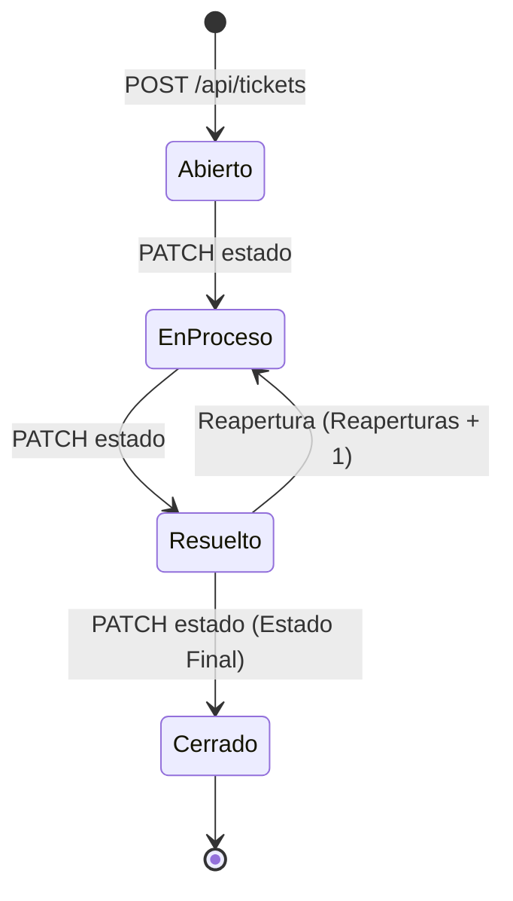

# Sistema de Soporte — API de Tickets (`Ticket.API`)

**Curso:** SC-701 Programación Avanzada en Web  
**Evaluación:** Práctica Programada 1 — Módulo de Tickets (Mesa de Ayuda)  
**Tecnologías:** .NET 10, ASP.NET Core Web API (Controllers + Minimal APIs), OpenAPI / Scalar, RFC 9457 (`ProblemDetails`), HTML5/CSS3/JS.

---

## 1. Descripción del Proyecto

`Ticket.API` es el módulo de gestión de tickets de soporte técnico construido bajo una **arquitectura en 4 capas estrictamente desacopladas**. El sistema implementa enrutamiento avanzado con restricciones personalizadas (`IRouteConstraint`), caché condicional HTTP mediante `ETag` / `If-None-Match`, paginación con metadatos en cabeceras HTTP, validación detallada por campo bajo el estándar **RFC 9457 (`application/problem+json`)** y una interfaz web estática interactiva.

### Variante Personal Implementada (`V = 3`)
| Parámetro | Configuración en Variante 3 |
| :--- | :--- |
| **Tamaño máximo de página (`tamano`)** | `40` registros por página (`10` por defecto) |
| **Formato de código de ticket** | `HD-NNNN` (generado automáticamente en el servidor, ej. `HD-0001` al `HD-0025`) |
| **Restricción de ruta personalizada** | `codigoTicket` (`^HD-\d{4}$`) implementada con `IRouteConstraint` |
| **Regla de negocio especial (`409 Conflict`)** | **Un agente no puede tener más de 5 tickets en estado `EnProceso` al mismo tiempo** |

---

## 2. Arquitectura en 4 Capas

La solución (`Ticket.API.sln`) está dividida en cuatro proyectos independientes siguiendo las reglas de arquitectura del curso:

```text
Ticket.API/
├── Abstracciones/                  # Capa de Contratos, Modelos, DTOs y Excepciones de Dominio
│   ├── Excepciones/                # TicketNotFoundException, TicketConflictException, TicketValidationException
│   ├── Interfaces/                 # ITicketDA, ITicketFlujo, IClienteDA
│   ├── Modelos/                    # Entidad Cliente
│   └── Ticket/                     # Entidad Ticket, Enums (EstadoTicket, PrioridadTicket), Requests y Responses
├── DA/                             # Capa de Acceso a Datos (En Memoria)
│   └── Implementaciones/           # TicketDA (25 tickets semilla) y ClienteDA (clientes 101-105)
├── Flujo/                          # Capa de Lógica de Negocio (Sin dependencia de Microsoft.AspNetCore.*)
│   └── Implementaciones/           # TicketFlujo (transiciones, regla V=3, correlativo HD-NNNN, validaciones)
├── Ticket.API/                     # Capa de Presentación HTTP (Controllers, Minimal APIs y wwwroot)
│   ├── Restricciones/              # CodigoTicketRouteConstraint (IRouteConstraint)
│   ├── wwwroot/                    # Interfaz web estática (tickets.html)
│   ├── TicketController.cs         # Endpoints REST en /api/tickets
│   └── Program.cs                  # Inyección de dependencias, ProblemDetails, OpenAPI/Scalar y Minimal APIs
├── DECISIONES.md                   # Justificación técnica y respuestas de arquitectura
└── README.md                       # Documentación e instrucciones de ejecución
```

### Principios Arquitectónicos Aplicados
1. **Controladores y Minimal APIs delgados:** Ningún endpoint contiene lógica de negocio; únicamente reciben la petición, delegan a `ITicketFlujo` y traducen el resultado o excepción de dominio a respuestas HTTP.
2. **Independencia de protocolo en `Flujo`:** El proyecto `Flujo` no referencia `Microsoft.AspNetCore.*`. Comunica errores de validación, inexistencia o conflicto mediante excepciones de dominio enriquecidas con diccionarios de campos (`TicketValidationException`, `TicketNotFoundException`, `TicketConflictException`).
3. **Inyección de Dependencias (DI):** Todos los servicios están registrados en `Program.cs` (`IClienteDA` e `ITicketDA` como `Singleton` para persistir la lista en memoria durante la ejecución; `ITicketFlujo` como `Scoped`).

---

## 3. Reglas de Negocio y Ciclo de Vida del Ticket

### Transiciones de Estado Válidas


- **Creación (`POST /api/tickets`):**
  - El código `HD-NNNN` lo calcula automáticamente el sistema (el valor enviado por el cliente se ignora).
  - Todo ticket nace en estado `Abierto`, con `Reaperturas = 0` y fechas asignadas por el servidor.
  - El `ClienteId` debe existir en `ClienteDA` (IDs válidos precargados: `101`, `102`, `103`, `104`, `105`).
- **Transiciones Inválidas (`409 Conflict`):**
  - Cualquier transición no listada en el diagrama anterior (por ejemplo, pasar de `Abierto` a `Resuelto` o `Cerrado`, o intentar modificar un ticket `Cerrado`) responde con `409 Conflict`.
- **Límite de Carga por Agente — Variante 3 (`409 Conflict`):**
  - Tanto al pasar un ticket a `EnProceso` (`PATCH /api/tickets/{id}/estado`) como al reabrirlo (`POST /min/tickets/{id}/reabrir`), si el agente asignado ya tiene **5 tickets en estado `EnProceso`**, la operación se rechaza con `409 Conflict`.

---

## 4. Contrato HTTP y Endpoints

Todos los errores `400`, `404` y `409` responden con `Content-Type: application/problem+json` (estándar **RFC 9457**). Los errores `400` de validación utilizan `ValidationProblemDetails`, incluyendo `title`, `detail` y el diccionario `errors` con los mensajes específicos de cada campo que falló.

| Método | Ruta | Estilo | Comportamiento y Respuestas |
| :--- | :--- | :--- | :--- |
| `GET` | `/api/tickets` | Controller | Lista paginada con filtros (`estado`, `prioridad`, `clienteId`, `desde`, `hasta`, `q`, `orden`, `pagina`, `tamano`). Devuelve `200 OK` con headers `X-Total-Count`, `X-Page`, `X-Page-Size` o `400 Bad Request` si algún parámetro es inválido. |
| `GET` | `/api/tickets/{id}` | Controller | Restricción `{id:int:min(1)}`. Devuelve `200 OK` con header `ETag`, `304 Not Modified` (sin cuerpo) si `If-None-Match` coincide con el `ETag` vigente, o `404 Not Found`. |
| `GET` | `/api/tickets/codigo/{codigo}` | Controller | Usa la restricción personalizada `{codigo:codigoTicket}` (`^HD-\d{4}$`). Devuelve `200 OK` o `404 Not Found` (si el formato no coincide, la ruta no hace match). |
| `POST` | `/api/tickets` | Controller | Crea un ticket en estado `Abierto`. Devuelve `201 Created` con header `Location` apuntando a `/api/tickets/{id}`, o `400 Bad Request` (`ValidationProblem`) si el body o `clienteId` son inválidos. |
| `PATCH` | `/api/tickets/{id}/estado` | Controller | Recibe `estado` (obligatorio), `agenteId` y `prioridad` (opcionales). Devuelve `200 OK`, `400 Bad Request`, `404 Not Found` o `409 Conflict`. |
| `GET` | `/min/tickets/resumen` | Minimal API (`MapGet`) | Devuelve `200 OK` con `{ "total": n, "porEstado": {...}, "porPrioridad": {...} }`. |
| `POST` | `/min/tickets/{id}/reabrir` | Minimal API (`MapPost`) | Reabre un ticket `Resuelto` pasándolo a `EnProceso` e incrementando `Reaperturas`. Devuelve `200 OK`, `404 Not Found` o `409 Conflict`. |
| `GET` | `/tickets.html` | Archivo Estático | Interfaz gráfica en `wwwroot/tickets.html` que consume el API mostrando la tabla de tickets, filtros por estado/prioridad/búsqueda/orden, paginación y ficha de detalle con `ETag`. |

---

## 5. Instrucciones para Correr el Proyecto

### Requisitos Previos
- Tener instalado el SDK de **[.NET 10.0](https://dotnet.microsoft.com/download)**.

### Paso a Paso desde Terminal
1. **Clonar el repositorio y entrar al directorio raíz:**
   ```bash
   git clone <URL_DEL_REPOSITORIO>
   cd Ticket.API
   ```

2. **Restaurar dependencias y compilar la solución:**
   ```bash
   dotnet build
   ```

3. **Ejecutar el servidor API:**
   ```bash
   dotnet run --project Ticket.API/Ticket.API.csproj
   ```

4. **Abrir en el navegador:**
   - **Interfaz Web de Tickets (`tickets.html`):**  
     [http://localhost:5172/tickets.html](http://localhost:5172/tickets.html) *(o `https://localhost:7066/tickets.html`)*
   - **Documentación Interactiva Scalar (OpenAPI):**  
     [http://localhost:5172/scalar/v1](http://localhost:5172/scalar/v1)
   - **Especificación OpenAPI JSON:**  
     [http://localhost:5172/openapi/v1.json](http://localhost:5172/openapi/v1.json)

---

## 6. Ejemplos Rápidos de Prueba (`curl`)

### Listar tickets filtrados y ordenados
```bash
curl -i "http://localhost:5172/api/tickets?estado=Abierto&prioridad=Alta&orden=-fecha&pagina=1&tamano=5"
```

### Consultar por ID y probar Caché Condicional (`ETag` / `304 Not Modified`)
```bash
# 1. Obtener el ticket y copiar el header ETag de respuesta
curl -i "http://localhost:5172/api/tickets/1"

# 2. Enviar el ETag en If-None-Match (responde 304 Not Modified sin cuerpo)
curl -i "http://localhost:5172/api/tickets/1" -H 'If-None-Match: "<PEGAR_ETAG_AQUI>"'
```

### Crear un nuevo ticket (`201 Created`)
```bash
curl -i -X POST "http://localhost:5172/api/tickets" \
  -H "Content-Type: application/json" \
  -d '{
    "titulo": "Error al generar reporte de cierre contable",
    "descripcion": "El sistema muestra timeout después de 30 segundos al exportar el balance.",
    "prioridad": "Alta",
    "clienteId": 101
  }'
```

### Cambiar estado y asignar agente (`PATCH`)
```bash
curl -i -X PATCH "http://localhost:5172/api/tickets/1/estado" \
  -H "Content-Type: application/json" \
  -d '{
    "estado": "EnProceso",
    "agenteId": 202,
    "prioridad": "Critica"
  }'
```

### Reabrir un ticket resuelto (`Minimal API`)
```bash
curl -i -X POST "http://localhost:5172/min/tickets/4/reabrir"
```
